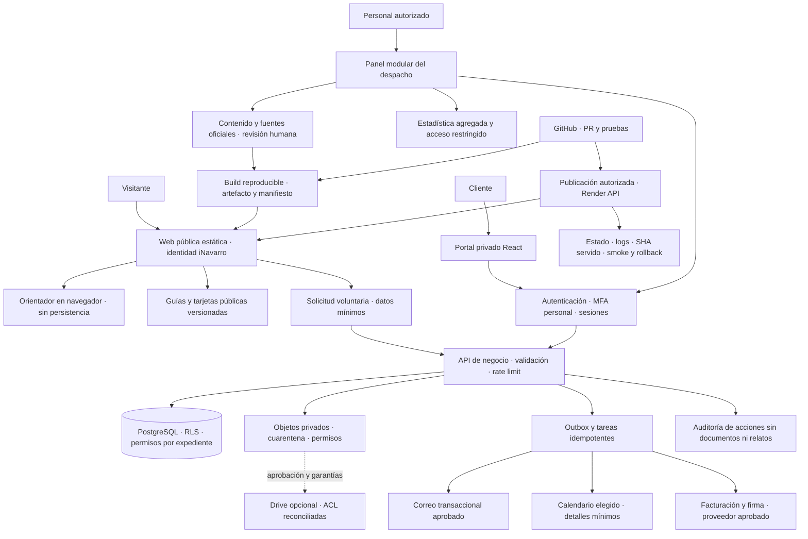

# C · Arquitectura recomendada

## Decisión

Modernización incremental: conservar la web pública estática y sus URLs, mantener el orientador local y extraer a archivos legibles el portal privado que ya existe. No conviene convertir todo a SSR, construir siete aplicaciones independientes ni contratar una nueva base de datos sin evaluar la existente.

Propuesta: una aplicación modular en TypeScript para los flujos de negocio, interfaz React existente, PostgreSQL/Auth/Storage con controles explícitos y funciones de servidor para operaciones privilegiadas. Supabase puede reutilizarse **si** se verifican región, contratos, RLS, backup, autenticación y costes. La alternativa es otro PostgreSQL/Auth/Storage gestionado en región aprobada; la migración no se decide antes de inventariar datos y restauración.

El hosting público puede continuar en Render Static Site. Las APIs y tareas requieren un runtime servidor autorizado (funciones gestionadas existentes o servicio adicional aprobado): el hosting estático por sí solo no recibe formularios, custodia secretos ni sincroniza calendarios.

No todos los componentes son nuevos servicios: son responsabilidades lógicas. Empezar con una API y un worker lógico, no microservicios. El diagrama es propuesto, no una descripción del despliegue verificado.

## Organización de código y release

Fase inicial: mantener los dos repositorios, pero reemplazar el tar manual por un artefacto CI con SHA de origen, checksum, lockfile, resultado de pruebas y versión de contenido. Extraer las entradas `source/` a una app mantenible sin cambiar su comportamiento primero. No alterar registros ni mover documentos durante esa extracción.

Como evolución opcional aprobable, consolidar en un monorepo con `apps/public`, `apps/portal`, `apps/api`, `packages/design`, `packages/schemas`, `packages/editorial` e `infra/migrations`. No hacer ese movimiento solo por preferencia estética. Next export ya utilizado es una opción para unificar páginas públicas gradualmente; no necesita servidor Next para generar HTML estático. Se preservan los slugs y se preparan redirecciones para cualquier excepción.

Cada release debe señalar SHA del portal, del orientador, del portal privado, versión editorial y checksums de artefactos; `deployment.json` actual solo acredita el SHA del ensamblador. CI no publica ni reutiliza expedientes reales. La protección de main y el modo autodeploy deben contrastarse con la configuración real, para que la autorización preceda a cualquier publicación.

## Modelo de datos propuesto

| Módulo | Entidades mínimas | Frontera |
| --- | --- | --- |
| Consultas | consultation, contact_method, status_history, privacy_notice_version | No crea un expediente ni cliente automáticamente; acceso de recepción limitado |
| Citas | appointment, reservation_hold, calendar_mapping, idempotency_key | Sin tema sensible en título de evento; reserva provisional hasta confirmación real |
| Editorial | article_version, source_reference, legal_review, publication, correction | Fuentes oficiales y revisor identificable; borrador/revisado/publicado/revisar vigencia |
| Carruseles | template_version, slide_content, approved_export | Solo contenido público aprobado; nunca expedientes como entrada |
| Expedientes | case, case_membership, document_metadata, audit_event | Permiso por usuario/asunto y documento; el texto interno no se comparte por defecto |
| Gestión económica | engagement_version, quote, invoice_reference, payment_status | Separar acceso contable del acceso al contenido jurídico; importes decimales, cambios auditados |
| Métricas | aggregate_event, daily_funnel | Agregados sin relatos, documentos, inferencias jurídicas ni identificadores de casos en analítica pública |

Roles iniciales: administrador técnico, letrado, recepción, editorial, contabilidad y cliente. Usar permisos por acción y recurso; «staff» único será insuficiente al crecer. Confirmar qué roles hacen falta realmente antes de crear cuentas. Acceso técnico a datos de clientes solo con habilitación expresa, temporal y auditada.

## Seguridad y privacidad por diseño

- Mantener documentos en almacenamiento privado, límites de bucket y validación servidor; cuarentena antes de compartir, descarga autorizada de corta duración, no URLs públicas permanentes.
- MFA para personal; verificar privilegios en servidor/RLS, no en estados React. Persistencia de sesión, recuperación, revocación y riesgo XSS documentados. No usar una clave service-role en frontend.
- Minimización: solicitud inicial sin DNI, documentos o detalles de salud/penales. No copiar automáticamente el orientador al CRM; transferencia voluntaria, revisable y definida aparte.
- Para España: revisar bases art. 6 RGPD, categorías especiales art. 9 y datos penales art. 10 según el tratamiento concreto; no asumir que un checkbox habilita todos los usos. Secreto profesional y separación de ámbitos internos/cliente.
- RGPD/LOPDGDD: registro de actividades, accesos, conservación por finalidad, encargados/subencargados, región, transferencias y garantías cuando procedan, gestión de derechos e incidentes. Evaluar necesidad de EIPD, sin afirmar que sea siempre obligatoria o innecesaria.
- LSSI-CE: identidad e información profesional, canales y comunicaciones comerciales; consentimiento comercial separado, no condicionado a consulta. Cookies/tecnologías opcionales solo tras revisión, sin banner vacío ni rastreadores por defecto.
- TLS, CSP y cabeceras configuradas realmente en Render; logs sin contenido jurídico. Backups cifrados con restauración probada. No se declara cumplimiento garantizado por adoptar esta arquitectura.

## Integraciones y coste de acoplamiento

Calendario y facturación deben usar adaptadores, IDs externos e idempotencia. No sincronizar descripciones jurídicas al calendario o al proveedor de correo. Preferir enlace de reserva externo inicialmente si el proveedor y tratamiento se aprueban; la sincronización bidireccional añade conflictos, webhook y renovaciones OAuth. Para facturación, evaluar un proveedor compatible con el marco español aplicable en el momento de contratación antes de construir un motor fiscal propio. No fijar calendarios normativos de SIF/VERI*FACTU o factura electrónica sin revisión actualizada.
